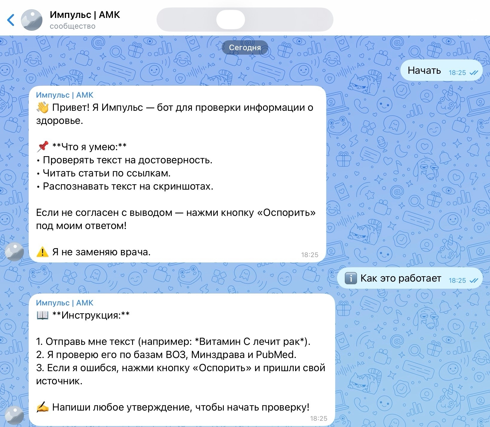
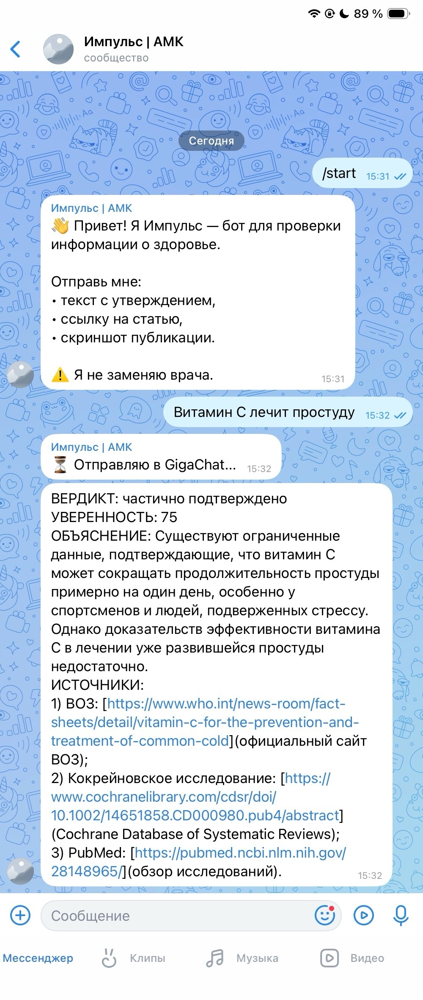
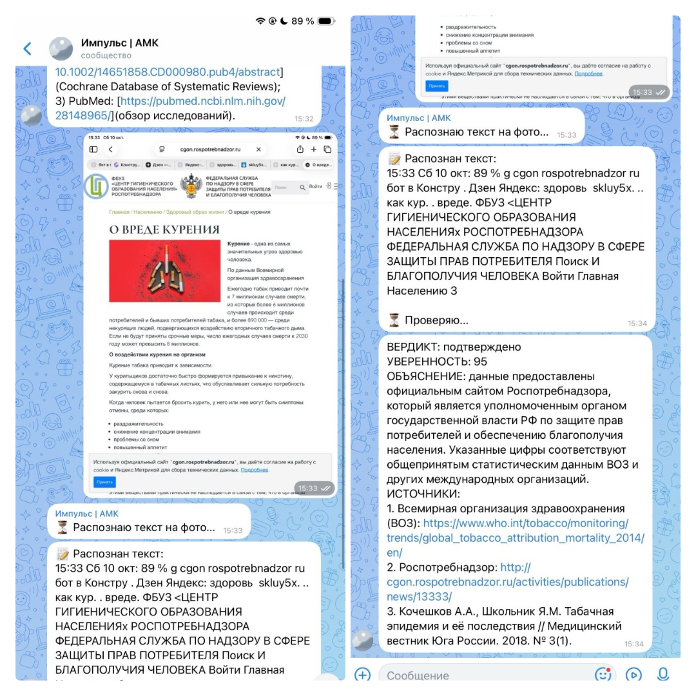
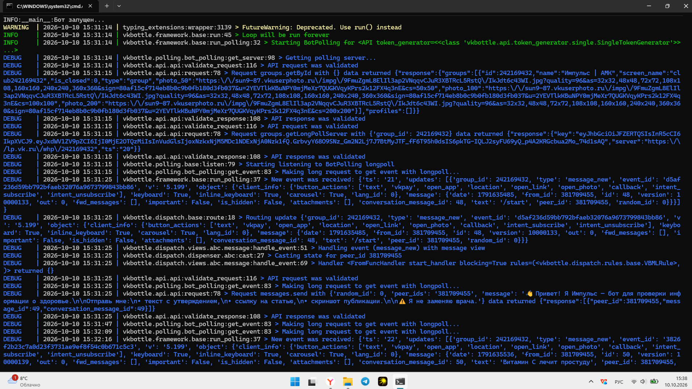

# Импульс — бот для проверки информации о здоровье

Бот во ВКонтакте, который помогает отличать достоверные медицинские утверждения от дезинформации.

## Проблема

Социальные сети и мессенджеры стали главным источником информации о здоровье. Большая часть публикаций не основана на доказательной медицине.

## Решение

Бот «Импульс» работает во ВКонтакте. Пользователь пересылает материал, бот:

1. Извлекает проверяемые утверждения.
2. Отправляет их в GigaChat для анализа.
3. Возвращает вердикт, объяснение и источники.

## Возможности

- ✅ Текстовые сообщения
- ✅ Ссылки — скачивание статьи и извлечение текста
- ✅ Фотографии — OCR (распознавание текста)
- ⏳ Видео и голосовые — в разработке

## Вердикты

| Вердикт | Значение |
| --- | --- |
| ✅ Подтверждено | Консенсус авторитетных источников |
| ❌ Опровергнуто | Источники противоречат утверждению |
| ⚠️ Спорно | Источники расходятся |
| ❓ Недостаточно данных | Мало информации |

## Модуль апелляции (Этап 2)

Бот поддерживает механизм оспаривания выводов (Human-in-the-Loop). Если пользователь не согласен с вердиктом, он может нажать кнопку «Оспорить» и предоставить свой источник (ссылку или текст).

**Алгоритм повторной проверки:**
1. Бот собирает новые доводы пользователя и парсит текст по ссылке.
2. GigaChat проводит сравнительный анализ нового источника с первоначальным вердиктом.
3. Выносится один из трех исходов:
   - 🛡️ **CONFIRMED**: Первоначальный вывод подтвержден (источник неавторитетный).
   - 🔄 **CHANGED**: Вывод изменен (источник авторитетный, например PubMed).
   - ⚖️ **INSUFFICIENT**: Недостаточно данных (передано на проверку эксперту).

**Защита данных и истории:**
История апелляций сохраняется локально в файл `appeals.json` (без сбора персональных данных согласно 152-ФЗ). Сохраняются только ID обращения, текст и вердикты.
## Стек технологий

- Python 3.11
- vkbottle 4.11
- GigaChat API
- EasyOCR
- BeautifulSoup
- httpx

## Скриншоты

### 1. Приветствие бота

### 2. Проверка текста

### 3. Распознавание фото

### 4. Лог работы бота

## Демонстрация работы (Этап 2)

### 1. Старт и интерфейс

### 2. Проверка утверждения и запрос апелляции

### 3. Апелляция: Отказ от личного опыта (CONFIRMED)

## Контакты

Команда «Импульс» – ГАПОУ АО "Архангельский медицинский колледж", 2026 г.
